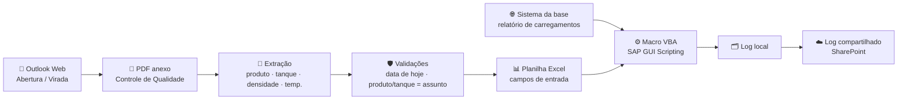

# 🛢️ Automação de Temperatura e Densidade — Terminal de Combustíveis

> **~6 horas por dia de trabalho manual do administrativo eliminadas.**
> Um robô em Python que lê os e-mails de qualidade dos tanques, preenche a planilha,
> atualiza o SAP e registra tudo em um log compartilhado — de 01:00 às 21:30, sem ninguém.


---

## 📌 O problema

Num terminal de distribuição de combustíveis, a temperatura e a densidade de cada produto
(gasolina, S10, S500, B100, etanol anidro e hidratado) precisam estar corretas no SAP —
elas entram no cálculo de volume a 20 °C de cada carregamento.

Esses dados chegam ao longo do dia por e-mail, num PDF de **Controle de Qualidade**:

- **Abertura de tanques** — logo após a meia-noite, com todos os produtos do dia;
- **Viradas de tanque** — a qualquer hora, quando um produto passa a sair de outro tanque
  (ex.: *"Virada de GAS p/ TQ 01 às 05h30"*).

O processo era **100% manual** e repetido o dia inteiro pelo administrativo:

1. Monitorar a caixa de e-mail e abrir cada abertura/virada;
2. Abrir o PDF e localizar densidade e temperatura da amostra do produto;
3. Digitar os valores na planilha de atualização;
4. Baixar o relatório de carregamentos do sistema da base;
5. Rodar a macro que atualiza o SAP — **a cada 30 minutos**;
6. Copiar o registro da atualização para o log compartilhado da equipe.

Resultado: horas por dia presas numa tarefa repetitiva, com risco de erro de digitação
num dado que impacta o faturamento.

## ✅ A solução

Um robô (Python + interface Tkinter) que faz o ciclo inteiro sozinho:



| Antes (manual) | Depois (robô) |
|---|---|
| Pessoa monitorando e-mail o dia todo | Leitura automática a cada 30 min |
| Digitação de densidade/temperatura | Extraído direto do PDF, com conferência |
| Macro rodada à mão | Até **42 atualizações/dia** (01:00 → 21:30) |
| Log copiado manualmente | Gravado no SharePoint a cada ciclo; limpo às 23:59 |
| **~6 h/dia do administrativo** | **~0 h** — só acompanhamento |

## 📈 Impacto

- ⏱️ **~6 horas/dia** de trabalho manual liberadas — **~30 h/semana** e **~130 h/mês** (22 dias úteis); como a operação roda todos os dias, chega a **~180 h/mês**.
- 🎯 **Zero digitação** de densidade/temperatura → elimina erro humano num dado que vai para o faturamento.
- 🌙 Atualização contínua inclusive de **madrugada**, quando a abertura de tanques chega.
- 🧾 **Rastreabilidade**: cada valor aplicado fica no log com o e-mail de origem e o horário a partir do qual vale.

> Ganho estimado pela equipe com base na rotina anterior.

## 🧠 Desafios técnicos resolvidos

**1. PDF com "linha fantasma"**
O PDF do controle de qualidade tem uma linha oculta desenhada quase na mesma altura da linha real.
A extração padrão misturava as duas (`GAS` + `EHC` → `GEHACS`, `20/10/2026` → `2200//1100//22002266`).
Solução: extrair o texto com tolerância vertical mínima (`pdfplumber`, `y_tolerance=0.2`), separando as camadas.

**2. Garantir que o PDF é do e-mail certo**
A lista de resultados do Outlook também mostra anexos de e-mails antigos. O robô:
- só aceita o anexo que está **no painel do e-mail aberto** (posição na tela, à direita do item clicado);
- confere se o **produto e o tanque do PDF batem com o assunto** (*"Virada de GAS p/ TQ 01"* ⇒ precisa vir GAS no TQ 1);
- aceita **somente dados do dia atual** (assunto, lista e coluna Data da tabela).

**3. Ordem cronológica e viradas futuras**
Cada e-mail é aplicado uma única vez; o mais recente vence por produto (virada das 05:30 substitui a abertura das 00:59).
Uma virada *"às 18h"* que chega às 16:47 **espera o horário** para entrar.

**4. Testar sem arriscar produção**
Como a atualização do SAP afeta o faturamento, foi criado um **modo teste**: lê os e-mails de verdade,
preenche uma **cópia** da planilha e grava num **log de cópia** — sem rodar a macro, sem tocar o SAP nem a rede.
O modo produção só foi ligado depois dos valores do teste baterem 100% com os digitados à mão.

**5. Robustez de um robô que roda sozinho**
- Chrome dedicado com perfil próprio (login persistente; o robô não fecha o navegador);
- se o relatório não baixar, a macro **não roda** (evita um `MsgBox` que travaria o Excel);
- trava de instância única, bloqueio de suspensão do Windows, *keep-alive* das sessões, notificação de erro na bandeja;
- janela de funcionamento configurável (01:00–21:30) e limpeza diária do log às 23:59.

## 🛠️ Tecnologias

- **Python 3.13** — orquestração, regras e interface (Tkinter)
- **Selenium** — Outlook Web e sistema da base (download do relatório)
- **pdfplumber** — extração de texto do PDF de qualidade
- **pywin32 (COM)** — Excel (planilha, macro VBA, log no SharePoint)
- **SAP GUI Scripting** — via macro VBA existente (transação de ajuste de temperatura)
- **schedule** — agendamento dos ciclos

## 🚀 Como rodar

> Requer Windows, Google Chrome, Excel desktop e SAP GUI com scripting habilitado.

```bat
instalar.bat          :: instala dependências e cria o config.json a partir do exemplo
:: edite o config.json (caminhos, URL do relatório, log compartilhado)
iniciar.bat
```

Comece **sempre** com `"modo_teste": true` no `config.json`. Só desligue depois de conferir
no log (`[TESTE] Colocaria no AMARELO ...`) que os valores batem com a operação.

## 📁 Estrutura

```
├── monitor_temperatura.py   # robô completo (e-mail → PDF → planilha → SAP → log)
├── config.example.json      # modelo de configuração (copie para config.json)
├── requirements.txt
├── instalar.bat / iniciar.bat
└── .gitignore               # planilhas, logs, cookies e config real nunca sobem
```

## 👤 Autor

**Caique Andrade** — Assistente de Operações e desenvolvedor de automações (Python/RPA) para logística de combustíveis.
[GitHub](https://github.com/CAIQUE4NDRADE)

> Projeto desenvolvido para uso interno; dados, endereços e documentos da operação foram removidos desta versão pública.
